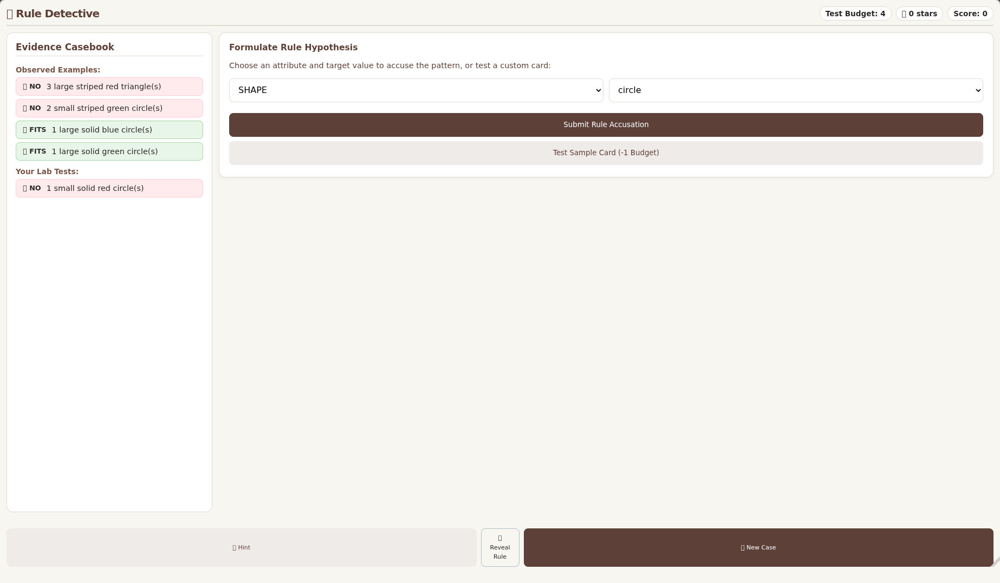

# Rule Detective

Deduce hidden card attribute rules using visual examples, hypothesis card tests, and structured rule formulas.

[Phone view](docs/phone.png) · [Game rules](docs/CORE-RULES.md)

The release candidate opened from Games → Learning & Strategy. The browser check played a turn and closed the window on phone, 1080p and 4K layouts. These screenshots show synthetic gameplay.

Run the native suite in the WebOS npm workspace with `node --test tests/*.test.mjs` from this directory.

Use **Game files → Save** to keep a round as `.rule-detective.json`. Open that file from WebOS Files to continue playing. Anon games stay in the browser until you register an account.
